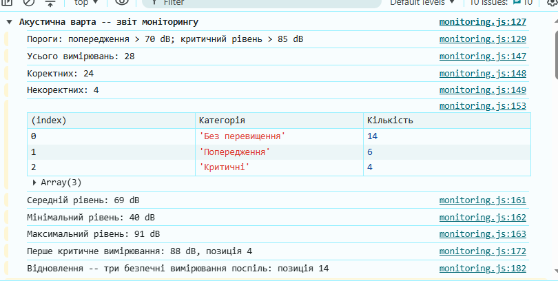
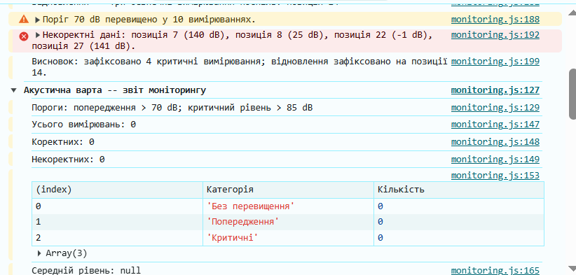
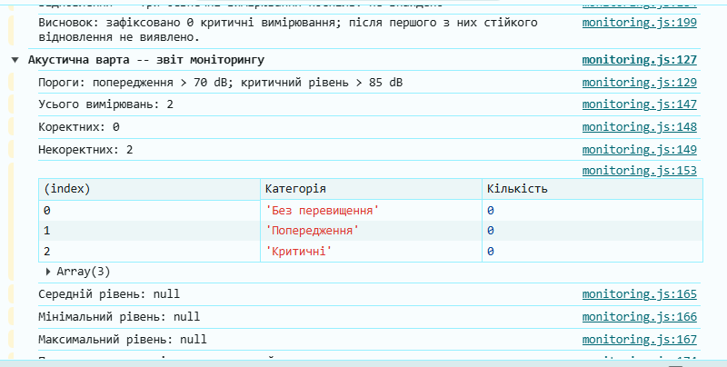
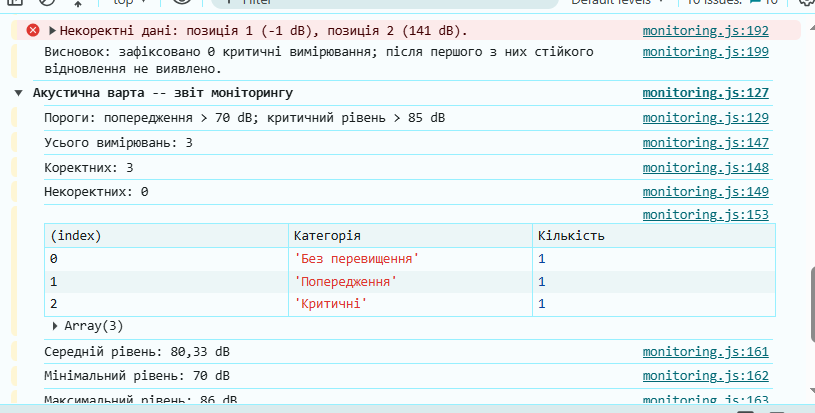
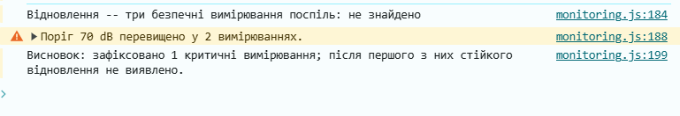

# Звіт до лабораторної роботи № 4

## Тема
**Назва лабораторної роботи:** Робота з циклами, функціями та функціональними виразами в JavaScript.

## Мета роботи
Реалізувати та пояснити алгоритм аналізу послідовності вимірювань: від перевірки даних і циклів до декомпозиції на функції та синхронної передачі функції як аргументу.

## Виконання роботи
Під час виконання лабораторної роботи було реалізовано:
* **підключено** зовнішній файл скрипта `js/monitoring.js` до структури вебсторінки `index.html` за допомогою атрибута `defer` та налаштовано роботу з консоллю браузера (DevTools Console);
* **реалізовано** алгоритми аналізу масиву вимірювань за допомогою циклів: цикл `for...of` для валідації та категоризації значень із пропуском некоректних даних (`continue`), обчислення середнього, мінімального та максимального рівнів шуму без застосування готових методів `Math.min`, `Math.max` чи `reduce`;
* **застосовано** різні типи циклічних конструкцій під окремі задачі: цикл `for` з числовим індексом та командою `break` для фіксації першого критичного вимірювання, цикл `while` для визначення моменту відновлення (серії з трьох безпечних вимірювань поспіль) та цикл `do...while` для знаходження першого коректного показника;
* **декомпозовано** загальний алгоритм на спеціалізовані функції з повторним використанням логіки перевірки коректності значень (`isValidLevel`);
* **використано** всі три форми запису функцій у JavaScript: оголошення функцій (Function Declaration), функціональний вираз (Function Expression, збережений у `const`), а також стрілкові функції (Arrow Function) з одним і кількома параметрами;
* **продемонстровано** механізм передачі функції як аргументу (callback) для підрахунку категорій шуму всередині іншої функції;
* **сформовано** структурований консольний звіт із групуванням (`console.group` / `console.groupEnd`), зведеною таблицею категорій (`console.table`), попередженнями про перевищення допустимих норм (`console.warn`) та діагностикою некоректних даних (`console.error`);
* **проведено** тестування працездатності алгоритмів на крайових наборах даних: на порожньому масиві `[]`, масиві некоректних значень `[-1, 141]` та контрольному ряді `[70, 85, 86]`.

## Результат
* **Посилання на опубліковану сторінку:**  
  [ephoriab5 P.S. Ruslan Yablonskyi KN41 pages](https://ephoriab5.github.io/web/)

* **Скріншоти результатів виконання роботи:**  
  
  
  
  
  

## Висновок
Під час виконання лабораторної роботи було практично опановано базові конструкції мови JavaScript для аналізу послідовностей числових даних. Було закріплено навички роботи з циклами (`for`, `for...of`, `while`, `do...while`), директивами переривання `continue` та `break`, а також практично освоєно декомпозицію коду на функції, відмінності між Function Declaration, Function Expression та Arrow Functions, механізм спливання (hoisting) та передачу функції у ролі аргументу (callback).
