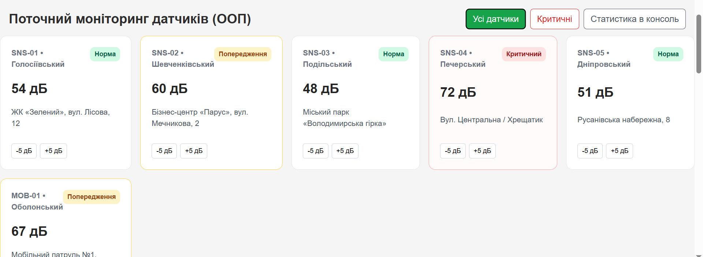
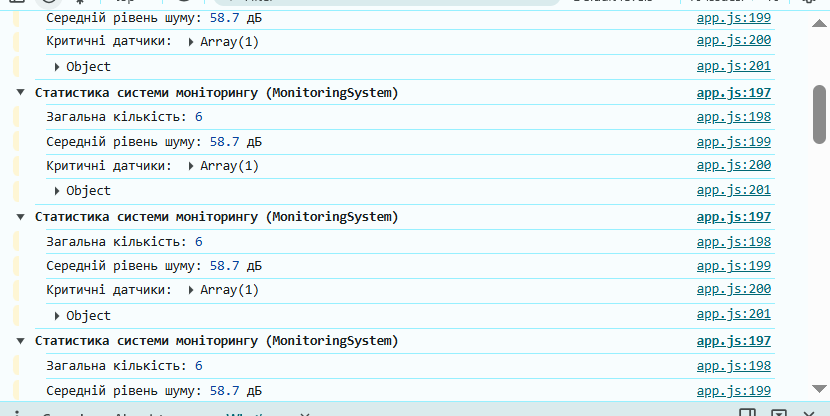

# Звіт до лабораторної роботи № 5

## Тема
**Назва лабораторної роботи:** Проєктування системи класів у JavaScript на прикладі навчального вебпроєкту «Акустична варта».

## Мета роботи
Навчитися переходити від набору окремих об’єктів і функцій до спроєктованої системи взаємопов’язаних класів: виділяти сутності предметної області, визначати їх стан і поведінку, розподіляти відповідальності, будувати композицію, аргументовано використовувати наслідування та інтегрувати об’єктну модель у наявний вебпроєкт.

## Виконання роботи
Під час виконання лабораторної роботи було реалізовано:
* **виділено сутності** предметної області «Акустична варта» (датчик `NoiseSensor`, вимірювання `NoiseMeasurement`, система моніторингу `MonitoringSystem`, мобільний датчик `MobileNoiseSensor`) та розподілено їхні відповідальності (стан і поведінку) без змішування з DOM-представленням;
* **централізовано бізнес-правила** класифікації рівнів шуму (до 55 dB — normal; від 55 dB до 70 dB — warning; понад 70 dB — critical) в окремому модулі `js/config/thresholds.js` із блокуванням мутацій за допомогою `Object.freeze()`;
* **створено клас `NoiseMeasurement`** для моделювання окремого вимірювання (значення шуму, час створення, форматування дати та обчислення статусу);
* **реалізовано клас `NoiseSensor`** із конструктором для ініціалізації унікального стану екземпляра (`id`, `district`, `location`, `noiseLevel`, `measurements`), методами `getStatus()`, `getStatusLabel()`, `updateNoiseLevel()` з внутрішньою валідацією, методом `addMeasurement()`, а також статичним методом валідації `static isValidNoiseLevel()` та фабричним методом `static fromObject()`;
* **побудовано композицію об'єктів** за допомогою класу `MonitoringSystem`, який керує масивом екземплярів `NoiseSensor` (`this.sensors`) та містить методи для роботи з колекцією: `addSensor()`, `findSensorById()`, `getSensorsByDistrict()`, `getCriticalSensors()`, `getAverageNoiseLevel()` та `getStatistics()`;
* **застосовано наслідування та `super()`** у підкласі `MobileNoiseSensor extends NoiseSensor`, який моделює мобільний різновид датчика, додає рівень заряду батареї (`batteryLevel`) та перевизначає поведінку оновлення вимірювань;
* **проведено консольні експерименти з прототипами**: перевірено роботу ланцюжка наслідування через `instanceof`, підтверджено збереження методів у прототипі (`sensorA.getStatus === sensorB.getStatus`), а також досліджено власні та успадковані властивості за допомогою `Object.hasOwn()`;
* **виконано рефакторинг структури файлів** за принципами модульності (ES Modules: `import` / `export`) із чітким розділенням на моделі (`models/`), сервіси (`services/`), конфігурацію (`config/`) та дані (`data/`);
* **інтегровано об'єктну модель у вебсторінку** у файлі `app.js`: реалізовано відображення карток сенсорів на основі об'єктів системи, динамічне присвоєння CSS-класів (`normal`, `warning`, `critical`), оновлення таблиці вимірювань та додано елементи управління для фільтрації та симуляції зміни показників шуму в реальному часі.

## Результат
* **Посилання на опубліковану сторінку:**  
  [ephoriab5 P.S. Ruslan Yablonskyi KN41 pages](https://ephoriab5.github.io/web/)

* **Скріншоти результатів виконання роботи:**  
  
  
  

## Висновок
Під час виконання лабораторної роботи було успішно здійснено перехід від процедурного стилю організації коду до об'єктно-орієнтованої архітектури на основі класів ES6. Було закріплено практичні навички проєктування класів, використання конструкторів і `this`, виділення поведінки в методи, роботи з прототипами (`prototype`, `Object.hasOwn`), організації композиції та аргументованого застосування наслідування (`extends`, `super()`). Отриману модель було розділено на ES-модулі та інтегровано у вебінтерфейс проєкту «Акустична варта».
