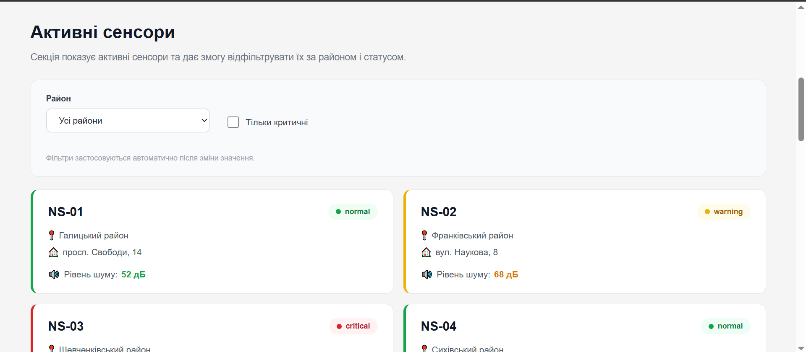
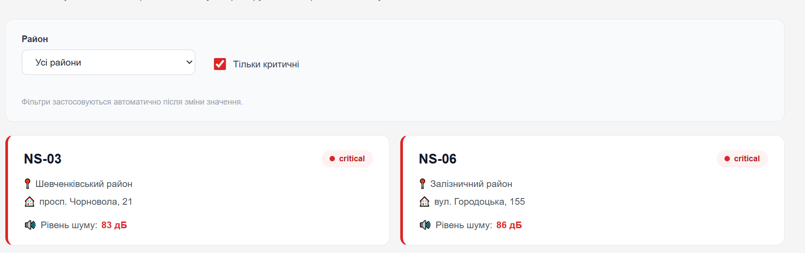
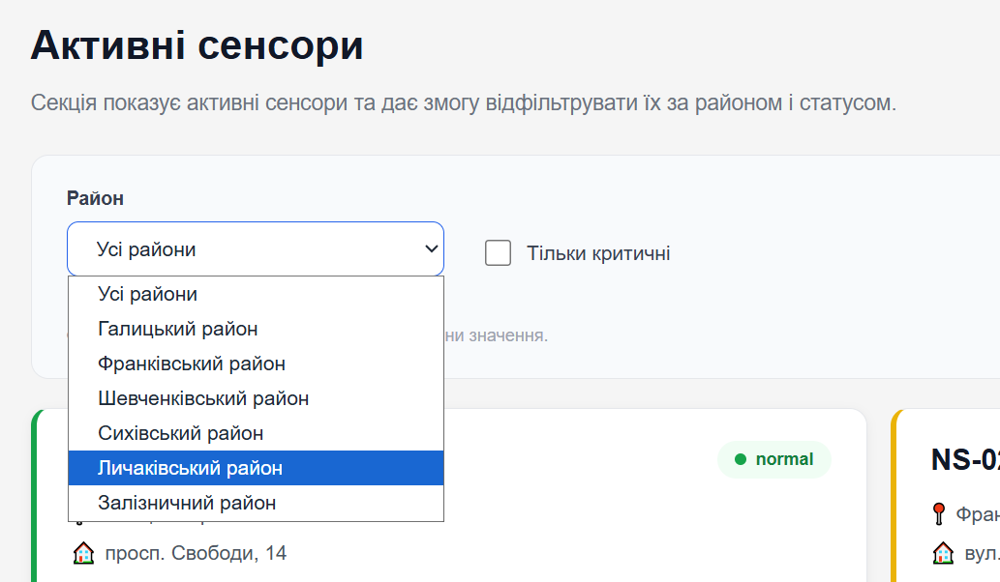
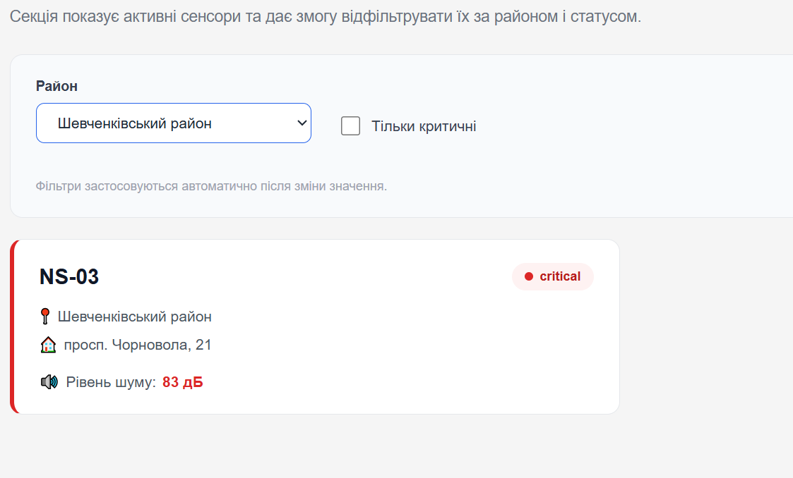

# Звіт до лабораторної роботи № 6

## Тема
**Назва лабораторної роботи:** Відображення та фільтрація сенсорів у DOM

## Мета роботи
Навчитися відображати дані сенсорів на існуючій сторінці «Акустична варта» та фільтрувати їх за районом і статусом. У цій роботі не потрібно додавати або видаляти сенсори, працювати з формами, localStorage чи іншими Browser API.

## Виконання роботи
Під час виконання лабораторної роботи було реалізовано:
* **додано секцію «Активні сенсори»** (`.active-sensors`) у файл `index.html` із заголовком, описом, панеллю фільтрації (випадаючий список вибору району `#district-filter`, чекбокс «Тільки критичні» `#critical-filter`) та порожнім контейнером `.sensor-list` для динамічного рендерингу карток;
* **підготовлено структуру даних** у модулі `js/data/sensorsData.js`: створено масив об'єктів сенсорів із параметрами `id`, `district`, `location`, `noiseLevel` та `status` (`normal`, `warning`, `critical`);
* **отримано посилання на DOM-елементи** за допомогою методу `document.querySelector()` для контейнера списку сенсорів та елементів керування фільтрацією;
* **реалізовано функцію `createSensorCard(sensor)`**, яка за допомогою `document.createElement()` формує DOM-елемент картки, безпечно заповнює текстові значення через властивість `textContent`, додає бейджі статусу з індикаторними крапками та призначає відповідні стильові класи залежно від рівня шуму;
* **розроблено функцію `renderSensors(sensorArray)`**, яка очищує вміст контейнера за допомогою `replaceChildren()` та додає згенеровані картки для кожного елемента масиву, а у разі порожнього результату виводить відповідне сповіщення;
* **створено функцію `applyFilters()`**, яка зчитує вибране значення району та стан чекбокса, фільтрує вхідний масив за допомогою методу `.filter()` за двома критеріями одночасно та викликає функцію повторного рендерингу;
* **налаштовано обробники подій** через `addEventListener("change", applyFilters)` для селекта району та чекбокса критичних значень, що забезпечує автоматичне оновлення відображених карток після будь-якої зміни фільтрів;
* **динамічно заповнено список районів** у селекті на основі унікальних значень із масиву даних за допомогою об'єкта `Set`;
* **стилізовано компоненти секції** у файлі `scss/main.css` відповідно до макета: налаштовано адаптивну сітку карток (1 колонка на мобільних пристроях, 2 колонки на десктопі), оформлено панель фільтрів, рамки, тіні та кольорову диференціацію статусів (зелений для `normal`, помаранчевий для `warning`, червоний для `critical`).

## Результат
* **Посилання на опубліковану сторінку:**  
  [ephoriab5 P.S. Ruslan Yablonskyi KN41 pages](https://ephoriab5.github.io/web/)

* **Скріншоти результатів виконання роботи:**  
  
  
  
  

## Висновок
Під час виконання лабораторної роботи було опановано базові методи взаємодії JavaScript із Document Object Model (DOM). Було закріплено практичні навички пошуку елементів за допомогою `querySelector()`, динамічного створення вузлів DOM через `createElement()`, наповнення їх текстом і класами без використання небезпечного конкатенування рядків, очищення та наповнення контейнерів. Також відпрацьовано фільтрацію даних масиву методом `filter()` та обробку подій зміни елементів форми через подію `change`.